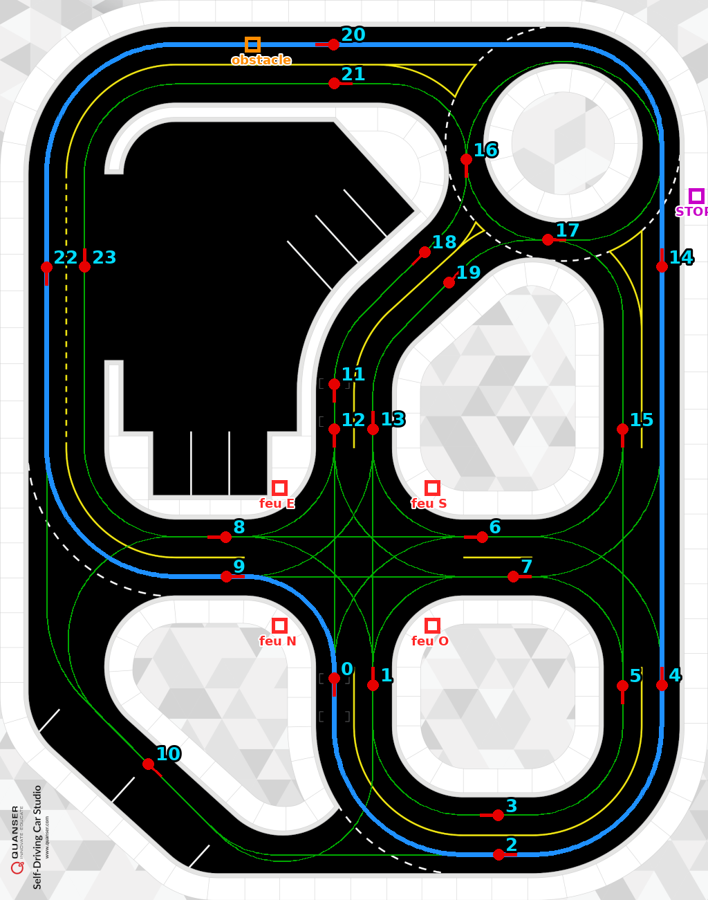
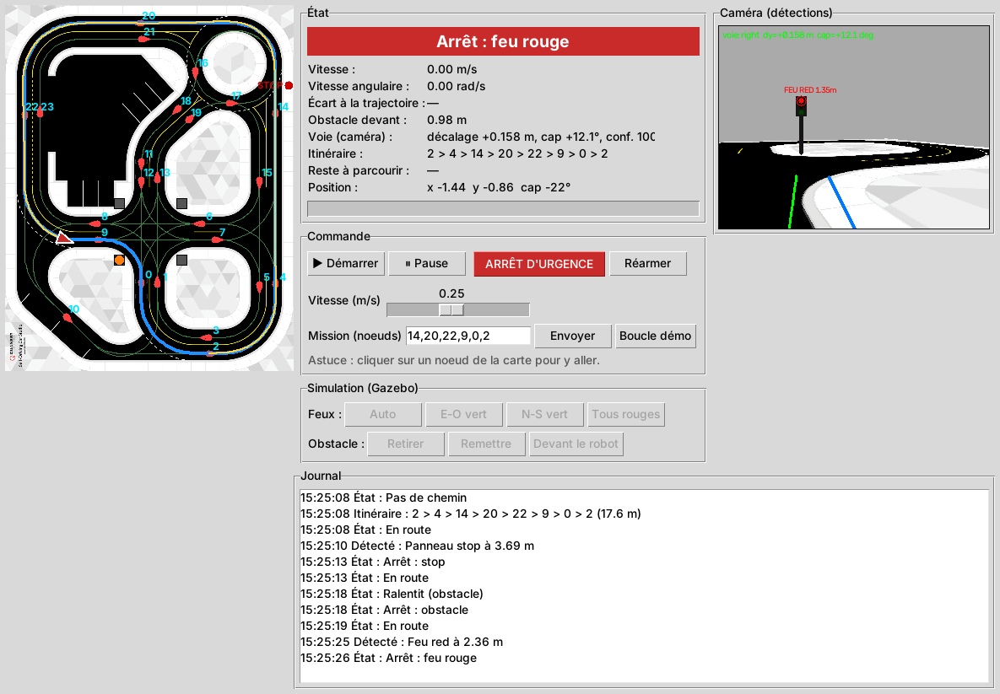

# be_limo — Livrables 2 et 3

Paquet ROS 2 Foxy du groupe 1 :

| Livrable | Date | Contenu | Où |
|---|---|---|---|
| **L2.1–L3.1** | 16/11/2026 | Simulation de planification, de contrôle et de détection | `launch/sim_l2.launch.py` |
| **L4.1** | 22/01 | Interface de supervision | `be_limo/supervisor_gui.py`, `launch/supervisor.launch.py` |

Même format que le README principal : 📍 **Où**, ⌨️ **Tape ça**, ✅ **Tu dois voir**, ❌ **Sinon**.

---

## 1. Ce que fait le paquet

Le robot part du nœud 2 et fait la **boucle de démonstration** `2 → 4 → 14 → 20 → 22 → 9 → 0 → 2` (17,6 m). En chemin, il :

1. **s'arrête 2 s au panneau STOP**, avant le rond-point ;
2. **ralentit puis s'arrête devant l'obstacle** sur la voie du haut, et repart quand on l'enlève ;
3. **s'arrête au feu rouge** du carrefour central, et repart au vert.



*En bleu : la boucle de démonstration. En rouge : les 24 nœuds de la carte (le numéro sert à donner un objectif). Carrés : feux, stop, obstacle.*

### Architecture (celle du Rendu 1)

```text
PROCÉDÉ        Gazebo ou limo_base ──► /odom  /scan  /rgb/image_raw
PERCEPTION     localization_node   ──► /robot_pose
               obstacle_detector   ──► /obstacle_distance  /obstacles
               vision_node         ──► /lane_detection  /detected_events  /vision/debug
PLANIFICATION  global_planner      ──► /plan  /plan/route        (objectif : /planner/goal, /goal_pose)
CONTRÔLE       local_controller    ──► /cmd_vel  /controller/state
SUPERVISION    supervisor          ──► /supervisor/command  /planner/goal  /supervisor/traffic_lights
SIMULATION     traffic_light_manager (allume les feux dans Gazebo)
               gazebo_twist_adapter  (/cmd_vel → /cmd_vel_gazebo, paquet limo_car)
```

| Nœud | Rôle | Fichier |
|---|---|---|
| `localization_node` | Position du robot sur la carte de la piste | `be_limo/localization_node.py` |
| `global_planner` | Plus court chemin (A*) sur le graphe des voies | `be_limo/global_planner_node.py`, `be_limo/roadmap.py` |
| `local_controller` | Suivi de trajectoire (pure pursuit) + machine à états (stop, feu, obstacle) | `be_limo/local_controller_node.py`, `be_limo/pure_pursuit.py` |
| `obstacle_detector` | Obstacles dans le couloir devant le robot (lidar) | `be_limo/obstacle_detector_node.py`, `be_limo/obstacles.py` |
| `vision_node` | Voie, feux, panneaux stop (caméra) | `be_limo/vision_node.py`, `be_limo/lane_vision.py`, `be_limo/sign_vision.py` |
| `traffic_light_manager` | Feux du carrefour dans Gazebo (simulation seulement) | `be_limo/traffic_light_manager.py` |
| `supervisor` | Interface de supervision (livrable 3) | `be_limo/supervisor_gui.py` |
| `teleop_web` | Téléopération web sur le vrai robot (section 10) | `be_limo/teleop_web_node.py`, `be_limo/teleop.py`, `web/teleop.html` |

Tous les réglages sont dans **`config/be_limo.yaml`**.

---

## 2. Installer (une fois)

📍 PC, terminal **hors conteneur** (`e70348u@...`) :
```bash
cd ~/ros2_ws/src/be-limo
git pull
```
✅ `Mise à jour ...` puis la liste des fichiers ajoutés (`be_limo/...`).

📍 **Dans le conteneur** (`docker start -ai foxy` ou `docker exec -it foxy bash`, invite `root@...`) :
```bash
cd /root/ros2_ws
rosdep install --from-paths src --ignore-src -r -y
colcon build --symlink-install --packages-select be_limo
source install/setup.bash
ros2 pkg executables be_limo
```
✅ La compilation finit par `1 package finished`, puis 7 lignes : `be_limo global_planner`, `be_limo local_controller`, `be_limo localization_node`, `be_limo obstacle_detector`, `be_limo supervisor`, `be_limo traffic_light_manager`, `be_limo vision_node`.
❌ `Package 'be_limo' not found` : vérifie que le dossier `src/be-limo/be_limo` existe (`ls src/be-limo`).

---

## 3. Lancer la simulation (livrable 2)

📍 Conteneur, terminal n°1 :
```bash
ros2 launch be_limo sim_l2.launch.py
```
✅ En 20 à 40 s s'ouvrent **RViz** (carte, chemin bleu, robot, lidar, image de la caméra) et la fenêtre **LIMO - Supervision**. La fenêtre Gazebo n'est **pas** ouverte : elle est trop lente sur les PC de la salle, et la simulation tourne quand même.
❌ Pour voir aussi Gazebo : `ros2 launch be_limo sim_l2.launch.py gui:=true`.
❌ `Package 'limo_car' not found` ou `'qcar_large_track'` : le workspace n'a pas été compilé en entier, refais `colcon build --symlink-install` (sans `--packages-select`).

Dans la fenêtre **Supervision**, clique sur **▶ Démarrer**.
✅ Le robot suit le chemin bleu. Le bandeau d'état passe par *En route → Arrêt : stop → En route → Ralentit (obstacle) → Arrêt : obstacle*.

Ensuite :
- **Obstacle** : clique sur **Obstacle → Retirer**. ✅ Le robot repart.
- **Feu rouge** : au carrefour central, il s'arrête si le feu est rouge et repart au vert (les feux changent toutes les 12 s). Tu peux forcer avec **Feux → Tous rouges**, puis **Auto**.
- **Fin de boucle** : il revient au nœud 2 et recommence (mode `demo`).

Autres lancements :
```bash
ros2 launch be_limo sim_l2.launch.py autostart:=true      # démarre sans cliquer
ros2 launch be_limo sim_l2.launch.py mission:=16          # aller au nœud 16
ros2 launch be_limo sim_l2.launch.py mission:=14,20,9     # passer par 14, 20, puis 9
ros2 launch be_limo sim_l2.launch.py start_node:=9        # partir du nœud 9
```

### Vérifier chaque partie séparément

📍 Conteneur, nouveau terminal (`docker exec -it foxy bash`) :

| Partie | ⌨️ Tape ça | ✅ Tu dois voir |
|---|---|---|
| Planification | `ros2 topic echo /plan/route --once` | `{"route": [2, 4, 14, 20, 22, 9, 0, 2], "length": 17.6...}` |
| Contrôle | `ros2 topic echo /controller/state` | `"state": "DRIVING"`, `"cross_track_error"` de quelques cm |
| Obstacles | `ros2 topic echo /obstacle_distance` | `inf` quand la voie est libre, ~0.35 devant l'obstacle |
| Voie | `ros2 topic echo /lane_detection` | `[1.0, décalage, cap, confiance]` sur les lignes droites |
| Feux / stop | `ros2 topic echo /detected_events` | `"type": "traffic_light", "state": "red"` en approchant du feu |
| Commande | `ros2 topic echo /cmd_vel` | `linear.x` ~0.25, `angular.z` qui varie dans les virages |

Donner un objectif à la main :
```bash
ros2 topic pub --once /planner/goal std_msgs/String "{data: '16'}"
ros2 topic pub --once /supervisor/command std_msgs/String "{data: '{\"cmd\": \"start\"}'}"
```
Dans RViz, l'outil **2D Goal Pose** envoie aussi le robot vers le nœud le plus proche du clic.

### Enregistrer pour le rapport
```bash
ros2 bag record /robot_pose /plan /cmd_vel /controller/state /obstacle_distance /detected_events -o essai_l2
```

---

## 4. Interface de supervision (livrable 3)



*Capture prise avec le simulateur hors ligne du dossier `test/` (images de caméra synthétiques). Dans Gazebo, l'image de la caméra est celle du robot simulé.*

| Zone | Contenu |
|---|---|
| **Carte** (gauche) | Piste, graphe des voies, nœuds numérotés, chemin planifié (bleu), robot (triangle, couleur = état), trace (jaune), obstacles vus par le lidar (orange), état des feux, panneau stop. **Clic sur un nœud = y aller.** |
| **État** | Bandeau coloré (En route, Arrêt : feu rouge...), vitesse, vitesse angulaire, écart à la trajectoire, distance de l'obstacle, voie vue par la caméra, itinéraire, reste à parcourir, barre de progression. |
| **Commande** | ▶ Démarrer, ⏸ Pause, **ARRÊT D'URGENCE**, Réarmer (après un arrêt d'urgence), vitesse (0,05 à 0,5 m/s), mission (liste de nœuds), Boucle démo. |
| **Simulation** | Feux (Auto, Est-Ouest vert, Nord-Sud vert, Tous rouges), obstacle (Retirer, Remettre, Devant le robot). Grisé avec le vrai robot. |
| **Caméra** | Image `/vision/debug` : voie détectée (vert), points de ligne (jaune et bleu), feux et stop entourés avec leur distance. |
| **Journal** | Changements d'état, détections, commandes, avec l'heure. |

Lancer l'interface seule (par exemple avec le vrai robot) :
```bash
ros2 launch be_limo supervisor.launch.py            # ajoute rviz:=true pour RViz
```

---

## 5. Sur le vrai robot

⚠️ Commencer **roues dans le vide**, puis au sol à **0,15 m/s**, avec quelqu'un à l'interrupteur.

**1. Installer le paquet sur le robot** (une fois)

📍 Robot (`ssh jetson@100.75.155.201`) :
```bash
cd ~/ros2_ws/src
git clone https://github.com/GiovanRD/be-limo.git
touch be-limo/limo/COLCON_IGNORE be-limo/environment/COLCON_IGNORE be-limo/room207-limo/COLCON_IGNORE \
      be-limo/teleoperation/COLCON_IGNORE be-limo/recording/COLCON_IGNORE
cd ~/ros2_ws
colcon build --symlink-install --packages-select be_limo
source install/setup.bash
```
✅ `1 package finished`. Les `COLCON_IGNORE` évitent de recompiler les copies des paquets du labo, déjà installés sur le robot.

**2. Poser le robot au nœud 2**, dans l'axe de la voie, dans le sens de la flèche (voir la carte). L'odométrie démarre à zéro : c'est cette position qui la relie à la carte.

**3. Lancer**

📍 Robot :
```bash
ros2 launch be_limo real_l2.launch.py initial_node:=2
```
✅ Le driver et le lidar démarrent (comme `limo_start`), puis `Planificateur prêt` et `Contrôleur prêt (en attente de "start")`.
❌ `limo_start` tourne déjà dans un autre terminal : ajoute `driver:=false` (un seul driver à la fois).

📍 PC, conteneur :
```bash
ros2 launch be_limo supervisor.launch.py
```
✅ La fenêtre montre le robot au nœud 2. Si elle reste vide (pas de position), le PC ne reçoit pas les topics du robot (voir README principal, section ROS_DOMAIN_ID). Dans ce cas, pilote en ligne de commande depuis le robot :
```bash
ros2 topic pub --once /planner/goal std_msgs/String "{data: '14'}"
ros2 topic pub --once /supervisor/command std_msgs/String "{data: '{\"cmd\": \"start\"}'}"
ros2 topic pub --once /supervisor/command std_msgs/String "{data: '{\"cmd\": \"estop\"}'}"   # arrêt
```

**Caméra** : le pilote `astra_camera` n'est pas installé sur la LIMO 201. Sans lui, la vision est désactivée (`use_camera:=false` par défaut) ; le robot fait la planification, le contrôle et l'arrêt aux obstacles. Une fois le pilote installé (`build-robot.sh` sans `--without-camera`) : `use_camera:=true`, puis régler `camera_height` et `camera_pitch` dans `config/be_limo.yaml`.

**Dérive** : sur le vrai robot, l'odométrie dérive (quelques cm par mètre). Pour recaler la position, utilise l'outil **2D Pose Estimate** de RViz, ou relance au nœud de départ. L'option `use_lane_correction: true` corrige la trajectoire avec la caméra (à tester une fois la caméra active). Pour une position qui ne dérive pas, utilise la **localisation lidar** (section 9).

---

## 6. Comment ça marche (pour le rapport et la soutenance)

### Planification — `roadmap.py`, `global_planner_node.py`
- La piste est un **graphe orienté** : 24 nœuds (entrées et sorties de carrefours, circulation à droite) et 41 arcs. Les positions viennent de la carte Quanser de la piste (`SDCS_RoadMap_RightHandTraffic.png`), converties dans le repère Gazebo (piste de 4,88 × 6,20 m centrée sur l'origine).
- Chaque arc est une courbe **ligne droite – arc de cercle – ligne droite**, avec le rayon de la voie (0,62 m voie intérieure, 0,89 m voie extérieure, 0,68 m rond-point). Un test vérifie automatiquement que tous les arcs restent sur la route noire.
- Le plus court chemin est calculé par **A\*** (heuristique : distance à vol d'oiseau). Le chemin part du nœud le plus proche **devant** le robot et orienté comme lui.

### Contrôle — `pure_pursuit.py`, `local_controller_node.py`
- **Pure pursuit** sur le modèle bicyclette (empattement L = 0,24 m), écrit à l'essieu arrière : le robot vise un point du chemin à la distance `Ld = 0,25 + 0,6·v` et braque de `δ = atan(2 L sin α / Ld)`. La commande envoyée est `v` et `ω = v tan δ / L` sur `/cmd_vel`, comme pour le vrai robot. En simulation, `gazebo_twist_adapter.py` la convertit pour le plugin Gazebo.
- Vitesse réduite dans les virages (`v = v₀ / (1 + 1,5 |κ|)`) et à l'approche de l'arrivée. Braquage limité à 23,6°.
- Le chemin se croise aux carrefours : la recherche du point le plus proche se fait seulement **vers l'avant** (fenêtre de 60 points), pour ne pas sauter sur une autre branche.
- **Machine à états**, par priorité : arrêt d'urgence > pause > pas de chemin ou de position > obstacle (arrêt sous 0,35 m, reprise au-dessus de 0,45 m) > feu rouge > stop (2 s, puis stop ignoré 6 s) > ralentissement (obstacle sous 0,8 m) > en route.
- Une détection doit être vue sur 2 images de suite avant d'être prise en compte.

### Détection — `obstacles.py`, `lane_vision.py`, `sign_vision.py`
- **Obstacles (lidar)** : les points du scan sont regroupés en amas. Un obstacle compte s'il est dans le **couloir** que le robot va balayer : un arc de la courbure actuelle (`ω/v`), de 2 × 0,16 m de large. Ainsi, un poteau au bord de la route n'arrête pas le robot en ligne droite, mais l'arrête s'il tourne vers lui.
- **Voie (caméra)** : masques de couleur HSV (ligne jaune centrale, bord blanc). Sur chaque ligne de l'image, on prend le premier point jaune à gauche et le premier blanc à droite, puis on les **projette au sol** (modèle sténopé, hauteur et inclinaison de la caméra connues) et on ajuste une droite par côté. On en tire le décalage latéral du centre de la voie à 0,7 m devant et l'angle de la voie.
- **Feux et stop (caméra)** : taches rouges ou vertes saturées **au-dessus de l'horizon** (les panneaux sont plus hauts que la caméra). Un disque entouré de sombre est un **feu**, un disque rouge entouré de blanc est un **stop**. La distance vient de la taille apparente (`d = f·D / diamètre_px`). Les feux sont placés **de l'autre côté du carrefour** : le robot les voit depuis la ligne d'arrêt et obéit au rouge seulement quand il est vu entre 1,0 et 1,4 m, donc pas une fois engagé dans le carrefour.

### Supervision — `supervisor_gui.py`
Tkinter + rclpy dans la même boucle (`spin_once` toutes les 50 ms). L'interface écoute les topics de tous les nœuds et publie les commandes (`/supervisor/command`, `/planner/goal`, `/supervisor/traffic_lights`). En simulation, elle appelle aussi les services Gazebo `/spawn_entity` et `/delete_entity` pour l'obstacle.

---

## 7. Tests sans ROS ni Gazebo

Les algorithmes et les nœuds sont testés sur n'importe quel PC (Python 3, numpy, OpenCV, pytest) :
```bash
cd ~/ros2_ws/src/be-limo/be_limo
python3 -m pytest -q test/
```
✅ `17 passed`.

| Test | Ce qui est vérifié |
|---|---|
| `test_every_edge_stays_on_the_road` | les 41 arcs du graphe restent sur la route (comparaison avec la texture de la piste) |
| `test_routes`, `test_every_node_reachable` | A*, et chaque nœud est atteignable depuis chaque nœud |
| `test_pure_pursuit_follows_the_demo_loop` | boucle complète en simulation cinématique, écart < 6 cm |
| `test_corridor_geometry`, `test_obstacle_in_front_and_beside` | couloir du lidar, en ligne droite et en virage |
| `test_lane_offset_and_signs` | décalage de voie à ±1,5 cm près, feux rouge et vert, stop, sur des images de synthèse |
| `test_room_map_calibration` | lien carte de la salle ↔ carte de la piste (localisation lidar) |
| `test_teleop.py` | téléopération : le driver retrouve le braquage demandé, rampe, chien de garde, arrêt, marche arrière |
| `test_demo_loop` | **les vrais nœuds ROS ensemble** autour d'un robot simulé (lidar et caméra synthétiques) : stop, obstacle, feu rouge, arrivée. Résultat : écart max 4 cm, arrêt à 0,40 m de l'obstacle. |

`test/offline_sim.py` est ce simulateur hors ligne (sans Gazebo), pratique pour essayer un changement en quelques secondes.

---

## 8. Limites connues et points à vérifier

Le code a été testé avec le simulateur hors ligne, mais **pas encore dans Gazebo ni sur le robot**. Au premier lancement, vérifier :

| Point | Comment vérifier | Si ça ne va pas |
|---|---|---|
| Les feux s'allument dans Gazebo | `gui:=true`, regarder le carrefour central | Voir le terminal : `traffic_light_manager` attend `/spawn_entity` |
| Le feu est détecté | Fenêtre caméra : cercle « FEU ROUGE » en approchant du nœud 9 | Régler `red_s`, `red_v` dans `sign_vision.py` (seuils de couleur) |
| Le stop est détecté | Cercle « STOP » en montant vers le nœud 14 | Idem, et `bright_v` |
| La voie est détectée | `/lane_detection` sur la ligne droite du haut | Seuils `yellow_low`, `white_min_v` dans `lane_vision.py` |
| Le robot ne s'arrête pas pour rien | `/obstacle_distance` en virage au carrefour | Réduire `half_width` dans `config/be_limo.yaml` |

Limites :
- Pas d'évitement d'obstacle : le robot **attend** que la voie se libère. Le graphe n'a presque jamais de voie parallèle pour contourner.
- La détection de voie est fiable en ligne droite (±1,5 cm), approximative dans les virages serrés. Elle sert au suivi et au recalage, pas au pilotage seul.
- Le panneau stop simulé est un disque (rouge bordé de blanc), pas un octogone.
- Sur le vrai robot, sans la localisation lidar (section 9), la position vient de l'odométrie seule et dérive sur un long parcours.
- La localisation lidar n'a pas encore été essayée sur le robot (section 9) : les réglages d'AMCL (`config/amcl.yaml`) seront peut-être à ajuster.

---

## 9. Localisation lidar (AMCL) : partir de n'importe où

Avec l'odométrie seule, le robot ne sait où il est que si on le pose sur un nœud connu, et sa position dérive. Avec une **carte lidar de la salle**, il se localise en continu en comparant ce que voit le lidar (murs, tables, pieds de chaises) avec la carte.

```text
map (piste)  ──►  room_map (carte lidar de la salle)  ──►  odom  ──►  base_link
   statique, calibré à la              AMCL                  limo_base
   cartographie
```

Le lien entre la carte de la salle et celle de la piste se fait automatiquement : on commence la cartographie avec le robot posé sur un nœud connu, et la carte lidar démarre exactement là. Ce lien est enregistré dans `~/maps/salle207_track.yaml`.

### 9.1. Faire la carte (une seule fois, environ 10 min)

Pose le robot au **nœud 2**, bien centré, dans le sens de la flèche. La piste et la salle doivent être dans leur état habituel : les objets déplacés ensuite (sacs, chaises) gênent la localisation.

📍 Robot, terminal 1 :
```bash
pkill -f limo_base; pkill -f ydlidar; pkill -f astra
sudo chgrp dialout /dev/ttyTHS1 && sudo chmod 660 /dev/ttyTHS1
ros2 launch be_limo mapping.launch.py start_node:=2 map:=~/maps/salle207.yaml
```
✅ `Calibration enregistrée : /home/jetson/maps/salle207_track.yaml`, puis `Localisé par le lidar`.

📍 Robot, terminal 2 : pilote **lentement** sur toute la piste, en passant partout au moins une fois et en revenant à la fin près du départ (ça aide la carte à se refermer correctement).
```bash
ros2 run teleop_twist_keyboard teleop_twist_keyboard
```
Touche `x` plusieurs fois pour réduire la vitesse vers 0,15 m/s ; `i` avancer, `j`/`l` tourner, `k` stop.

Pour voir la carte se construire : sur le PC, dans le conteneur, lance `rviz2`, mets **Fixed Frame** sur `room_map` et ajoute un affichage **Map** sur `/map`.

📍 Robot, terminal 3, quand tout est parcouru : enregistrer la carte.
```bash
ros2 run nav2_map_server map_saver_cli -f ~/maps/salle207
ls ~/maps
```
✅ `salle207.pgm`, `salle207.yaml`, `salle207_track.yaml`.

Arrête ensuite le terminal 1 (Ctrl+C).

### 9.2. Rouler avec la localisation lidar

📍 Robot, robot posé **sur n'importe quel nœud**, par exemple le 9 :
```bash
ros2 launch be_limo real_l2.launch.py localization:=lidar map:=~/maps/salle207.yaml initial_node:=9 mission:=demo use_camera:=true
```
✅ `Pose initiale envoyée à AMCL`, puis `Localisé par le lidar : x=... y=...`, avec la position du nœud 9 (voir la carte).
❌ `Calibration introuvable` : la carte n'a pas été faite, ou n'est pas à cet endroit (section 9.1).
❌ Le robot ne se localise pas (reste sur `En attente de la localisation lidar`) : vérifie que le lidar tourne (`ros2 topic hz /scan`) et que la carte se charge (`ros2 topic echo /map --once | head`).

Démarrage et arrêt comme en section 5. Robot posé ailleurs que sur un nœud : donne sa position avec **2D Pose Estimate** dans RViz (Fixed Frame `map`). Notre programme la transmet à AMCL.

Vérifier que la localisation suit bien : pousse le robot à la main de 50 cm, ou fais-le rouler, et regarde que `ros2 topic echo /robot_pose` suit son déplacement réel.

---

## 10. Téléopération web (robot réel)

Une page web pour **voir** le robot (vue de dessus avec les roues et leur braquage, lidar, caméra, mesures) et le **piloter** à la main (vitesse, braquage). Le nœud `teleop_web` tourne **sur le robot** et sert la page ; on l'ouvre dans le navigateur du PC.

Pourquoi une page web et pas RViz ou l'interface Tkinter : le PC (100.64.212.x) et le robot (100.75.155.x) sont sur deux sous-réseaux différents, et la découverte DDS de ROS 2 ne passe pas entre eux (le conteneur ne voit aucun topic du robot). Une connexion TCP, comme SSH, passe.

📍 Robot (`ssh jetson@100.75.155.201`) :
```bash
pkill -f limo_base; pkill -f ydlidar; pkill -f astra       # un seul driver
ros2 launch be_limo teleop.launch.py                       # driver + lidar + caméra + interface
```
✅ `Interface de téléopération : http://127.0.0.1:8080`.
❌ `real_l2` tourne déjà : `ros2 launch be_limo teleop.launch.py driver:=false` (pas de caméra si `real_l2` a été lancé sans `use_camera:=true`).

📍 PC, terminal **hors conteneur** (`e70348u@...`) : ouvrir le tunnel, puis le navigateur.
```bash
ssh -N -L 8080:localhost:8080 jetson@100.75.155.201
```
Laisse ce terminal ouvert, et ouvre **http://localhost:8080** dans Firefox.
✅ Badge vert « Robot : connecté », image de la caméra, points orange du lidar autour du robot.
❌ `bind: Address already in use` : un tunnel est déjà ouvert, ouvre directement la page.

| Zone | Contenu |
|---|---|
| **Vue de dessus** | Robot, lidar (orange), trajectoire prévue sur 1 m (vert). Encart agrandi : angle de **chaque roue avant** (Ackermann : la roue intérieure braque plus). Bleu plein = braquage envoyé, bleu pointillé = consigne, violet pointillé = braquage déduit de l'odométrie. |
| **Caméra** | `/rgb/image_raw`, réduite à 320 px, ~8 images/s. |
| **Commande** | Armer, curseurs vitesse et braquage, vitesse max, « braquer à l'arrêt ». Clavier, mode **Maintenir** (défaut) : tenir `Z`/↑ avance à la vitesse max, `S`/↓ recule, lâcher = freinage ; tenir `Q`/← ou `D`/→ braque, lâcher = roues droites. Mode **Pas à pas** : chaque appui change la consigne (±0,02 m/s, ±2°). `Entrée` armer/désarmer, `X` vitesse 0, `C` braquage 0, **`Espace` ARRÊT**. |
| **Mesures** | v, ω et braquage : envoyés, sur `/cmd_vel`, vus par `/odom`, gyroscope `/limo/imu`. Un avertissement apparaît si l'odométrie ne voit pas un virage demandé. |

Sécurité :
- Rien n'est envoyé sur `/cmd_vel` tant que la commande n'est pas **armée** ; on arme toujours à vitesse 0. À l'armement, `local_controller` reçoit `pause`.
- La page envoie la commande 10 fois par seconde. **Sans nouvelles pendant 0,5 s** (onglet fermé, réseau coupé), le robot s'arrête et se désarme. Il s'arrête aussi si l'onglet est caché ou si la fenêtre perd le focus.
- Vitesse en rampe (0,5 m/s²), bornée par `max_speed` (0,30 m/s, `teleop.launch.py max_speed:=...`) et par le curseur « vitesse max » (0,15 par défaut).
- Un seul onglet pilote à la fois.
- Le serveur n'écoute que `localhost` : il faut l'accès SSH au robot. `host:=0.0.0.0` l'ouvre à tout le réseau de l'école (à éviter).

Braquer à l'arrêt : en Ackermann, `limo_base` remet les roues droites quand la vitesse est nulle. L'option envoie une vitesse de 0,0002 m/s, que le driver arrondit à 0 mm/s, avec le braquage : les roues braquent sans que le robot avance. Pratique roues en l'air pour vérifier le braquage.

Cinématique : la page donne (v, δ) ; le nœud envoie `ω = v·tan δ / L` avec **L = 0,20 m**, l'empattement utilisé par `limo_base`, qui retrouve ainsi exactement δ (`be_limo/teleop.py`, testé dans `test/test_teleop.py`).
